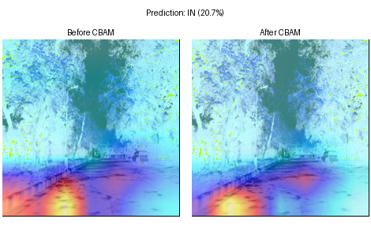

# GeoGuesserIA

**Where in the world was this photo taken?**
GeoGuesserIA is a deep learning project that predicts the **country** and the **GPS coordinates** of a street-level image, the same challenge players face in the game [GeoGuessr](https://www.geoguessr.com/).

The project compares several computer vision approaches (CNNs, attention modules, Vision Transformers and self-supervised features with nearest-neighbour search), all trained and evaluated on the [OpenStreetView-5M (OSV5M)](https://huggingface.co/datasets/osv5m/osv5m) dataset, published at CVPR 2024. The results can be explored in an interactive **Streamlit** application.

---

## Table of contents

- [The task](#the-task)
- [Dataset](#dataset)
- [Models](#models)
- [Results](#results)
- [Explainability](#explainability)
- [Streamlit application](#streamlit-application)
- [Repository structure](#repository-structure)
- [Installation](#installation)
- [Running the application](#running-the-application)

---

## The task

From one street-level image, the models estimate:

| Output                                          | Type           | Metric                                                                   |
| ----------------------------------------------- | -------------- | ------------------------------------------------------------------------ |
| **Country**                               | Classification | Accuracy, F1-score                                                       |
| **GPS coordinates** (latitude, longitude) | Regression     | Haversine distance in km (mean, median), accuracy within 1 / 25 / 200 km |

Dataset

We use **[OSV5M](https://huggingface.co/datasets/osv5m/osv5m)**, about 5 million geotagged street-view images from around the world. Each image comes with its GPS coordinates, country and extra metadata (land cover, road index, etc.).

Our exploratory data analysis ([dataset_OSV5M/Analyze_dataset/](dataset_OSV5M/Analyze_dataset/)) found two main difficulties:

- **Strong geographic imbalance.** The United States alone accounts for about 24% of the images (~870k), far ahead of Germany, France and Russia (~170–190k each), while many countries have very few images.
- **Few visual clues.** Most images show roads surrounded by vegetation (forests are the dominant land cover class). Roads often look alike from one country to the next, which makes the task hard.

We also tested other datasets first (a 50k-image Kaggle GeoGuessr dataset and FLAIR) and dropped them, mostly because GPS labels were missing or could not be matched.

## Models

All models take a single image as input. The training code is in [model/](model/) and the cluster job scripts are in [job/](job/).

| Model                                          | Approach                                                                                                                                                                                                                            | Output        | Code                                                                          |
| ---------------------------------------------- | ----------------------------------------------------------------------------------------------------------------------------------------------------------------------------------------------------------------------------------- | ------------- | ----------------------------------------------------------------------------- |
| **ResNet18 / ResNet50 regression**       | ImageNet-pretrained CNN that directly regresses coordinates encoded as `(sin, cos)` of latitude and longitude. Hyperparameters tuned with Optuna.                                                                                 | GPS           | [model/cnn/resnet/](model/cnn/resnet/)                                         |
| **ResNet50 classification + regression** | Two heads: a country classifier, and a GPS regressor that also receives the country probabilities (a coarse-to-fine approach).                                                                                                      | Country + GPS | [model/cnn/resnet/](model/cnn/resnet/)                                         |
| **ResNet50 geographic cells**            | The world is split into k-means cells; the model predicts a cell and returns its centre as the GPS estimate.                                                                                                                        | GPS           | [model/cnn/resnet/resnet_full_classif/](model/cnn/resnet/resnet_full_classif/) |
| **ResNet50 + CBAM**                      | ResNet50 with a [CBAM](https://arxiv.org/abs/1807.06521) attention module (channel + spatial attention) inside every bottleneck block, so the network focuses on small, local clues such as signs or road markings.                  | Country + GPS | [model/cnn/cnn_with_attention_module/](model/cnn/cnn_with_attention_module/)   |
| **ViT-B/16**                             | Vision Transformer that regresses a 3D point `(x, y, z)` on the unit sphere, which is then converted back to latitude/longitude.                                                                                                  | GPS           | [model/ViT/](model/ViT/)                                                       |
| **DINOv2 + KNN**                         | No end-to-end training: self-supervised DINOv2-large features are extracted for a reference set of images, and a new image is located from its nearest neighbours (temperature weighting and a constraint on the majority country). | Country + GPS | [model/KNN_variés/](model/KNN_variés/)                                       |
| **StreetCLIP** *(baseline)*            | Existing state-of-the-art geolocation model from Hugging Face, used as a reference point.                                                                                                                                           | Country + GPS | [model/StreetClip/](model/StreetClip/)                                         |

## Results

Our best approach is **DINOv2 + KNN**. Test-set results:

| Model                      | Country accuracy | Median error   | Mean error | ≤ 25 km | ≤ 200 km |
| -------------------------- | ---------------- | -------------- | ---------- | -------- | --------- |
| DINOv2-large + KNN (k = 3) | **84.7%**  | 18 km          | 942 km     | 54.0%    | 73.6%     |
| DINOv2-large + KNN (k = 7) | **85.3%**  | 28 km          | 928 km     | 48.4%    | 73.0%     |
| ViT features + KNN (k = 1) | 78.0%            | **9 km** | 1 414 km   | 60.0%    | 71.9%     |

## Explainability

To understand *what* the models look at, the project includes several visualisation tools ([visualisation/gradcam.py](visualisation/gradcam.py), [visualisation/gradcam_streamlit.py](visualisation/gradcam_streamlit.py)):

- **Grad-CAM heatmaps** for the CNNs, showing which parts of the image drove the prediction. For ResNet50 + CBAM, heatmaps taken before and after the attention module show its effect directly: attention moves away from the sky or the car bonnet and towards signs, vegetation and ground texture.
- **Attention Rollout** for the ViT, showing which 16×16 patches mattered most.
- **Feature maps** of the intermediate layers.
- **t-SNE projections** of the learned features, coloured by country or by land cover.



## Streamlit application

The web app ([visualisation/streamlit_app.py](visualisation/streamlit_app.py)) has four pages:

1. **Project overview**: goal and context.
2. **Dataset analysis**: land cover, road index, geographic distribution and t-SNE of the features.
3. **Model descriptions**: architecture and key ideas of each model.
4. **Prediction**: upload an image, pick a model, and get the predicted country, a confidence score, the location on an interactive map, and a Grad-CAM heatmap of what the model looked at.

## Repository structure

```
GeoGuesserIA/
├── dataset_OSV5M/           # Dataset download, CSV preparation and exploratory analysis (EDA)
├── model/
│   ├── cnn/                 # From-scratch CNNs, ResNet variants, ResNet50 + CBAM
│   ├── ViT/                 # Vision Transformer training, evaluation and inference
│   ├── KNN_variés/          # DINOv2 / ViT features + KNN, with result summaries
│   ├── StreetClip/          # StreetCLIP benchmark (baseline)
│   └── wip_*.md             # Experiment logs and model comparisons
├── visualisation/           # Streamlit app, Grad-CAM and dataset analysis pages
├── job/                     # SLURM scripts to train / evaluate / serve on the GPU cluster
├── model_internet_pickup/   # Reference notebooks (CNN, ViT)
├── Hugging_face_test/       # First StreetCLIP experiments
├── Note_word_classées/      # Meeting notes, state of the art, mid-project presentation (in French)
├── environment.yml          # Conda environment
└── wip_plan.md              # Outline of the final report
```

## Installation

**Requirements:** Python 3.9 and Conda. A GPU is strongly recommended for training.

```bash
# 1. Clone the repository
git clone https://github.com/fannnyyy/GeoGuesserIA.git
cd GeoGuesserIA

# 2. Create and activate the Conda environment
conda env create -f environment.yml
conda activate geoguesseriassh
```

3. **Add the trained weights.** The model checkpoints are too large for GitHub and are not included in this repository. Put the `saved/` folder in `GeoGuesserIA/model/`.

## Running the application

**Locally:**

```bash
cd visualisation
streamlit run streamlit_app.py
```

Then open http://localhost:8501.
